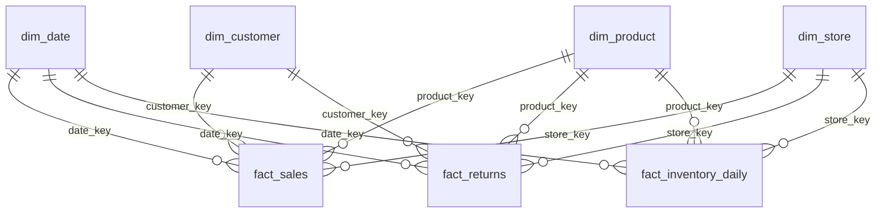

# Design: Harborline Retail Medallion Platform

> End-to-end medallion architecture in Microsoft Fabric for a fictional US retailer.
> This document is the source of truth for the platform's scope, data contracts and standards.

| | |
|---|---|
| **Author** | Karen Gomez |
| **Status** | Phase 3 in progress (storage + framework tables) |
| **Platform** | Microsoft Fabric (Lakehouse, Data Pipelines, Dataflow Gen2, Notebooks, Activator, Power BI) |
| **Workspaces** | `Retail Medallion Dev` → `Retail Medallion Prod` (deployment pipeline) |
| **Repository** | `fabric-retail-medallion` (Fabric items synced to `/fabric`) |

---

## 1. Business context

**Harborline Retail** runs 24 physical stores across 17 US states plus an e-commerce site and mobile app.
Sales are about **$45M per year** across 8 product categories, with roughly 50,000 customers.

The analytics platform must answer:

| # | Business question | Served by |
|---|---|---|
| Q1 | How are sales trending by store, region, channel and category? | `fact_sales`, `agg_daily_store_sales` |
| Q2 | Which products and customers drive revenue and margin? | `fact_sales`, `dim_product`, `dim_customer` |
| Q3 | What are return rates, and why are items returned? | `fact_returns` |
| Q4 | Where and how often do we run out of stock? | `fact_inventory_daily` |
| Q5 | How do holidays and promotions affect sales? | `fact_sales`, `dim_date` |
| Q6 | How do customers move between loyalty tiers over time? | `dim_customer` (SCD Type 2) |

---

## 2. Architecture

[](images/architecture.svg)

*Click the diagram to open it full size. A PNG copy (`images/architecture.png`) is included for slides and LinkedIn posts; the diagram is regenerated by `images/make_architecture_svg.py`.*

| Layer | What happens | Fabric items |
|---|---|---|
| 1 · Sources | Seven simulated systems drop daily files plus a public holidays API | `data_generator` |
| 2 · Ingestion | Metadata-driven copy from the landing zone, holidays via Dataflow | `lh_source`, `pl_ingest_batch`, `df_bronze_holidays` |
| 3 · Bronze | Raw, append-only Delta tables with ingest metadata | `lh_bronze` |
| 4 · Silver | Clean, type, dedupe, MERGE, SCD Type 2; failed rows quarantined | `nb_silver_*`, `nb_dq_checks`, `lh_silver` |
| 5 · Gold | Star schema with 4 dimensions, 3 facts and 1 aggregate | `nb_gold_*`, `lh_gold` |
| 6 · Serving | Direct Lake semantic model with RLS, reports, sales forecast | `sm_retail_sales`, `rpt_*`, `ml_sales_forecast` |
| Operations | Orchestration, audit logging, alerting | `pl_master_daily`, `lh_framework`, `act_pipeline_alerts` |

**Orchestration:** `pl_master_daily` runs ingestion → Silver → data quality → Gold → semantic model refresh, writing every step to the audit log.

### Why this shape
- **Source drop lakehouse (`lh_source`)** stands in for an SFTP server or vendor storage account. Ingestion reads from it exactly as it would from an external system, so swapping in a real source later only changes the connection, not the pattern.
- **One lakehouse per layer** keeps permissions and lineage clear, and lets Gold be shared without exposing raw data.
- **Framework lakehouse** separates operational metadata (what to load, what was loaded, how it went) from business data.

---

## 3. Workspace items and naming conventions

| Item type | Prefix | Items |
|---|---|---|
| Lakehouse | `lh_` | `lh_source`, `lh_bronze`, `lh_silver`, `lh_gold`, `lh_framework` |
| Data pipeline | `pl_` | `pl_ingest_batch`, `pl_master_daily` |
| Dataflow Gen2 | `df_` | `df_bronze_stores`, `df_bronze_holidays` |
| Notebook | `nb_` | `nb_bronze_load`, `nb_silver_<entity>`, `nb_dq_checks`, `nb_gold_<table>`, `nb_utils`, `nb_maintenance` |
| Environment | `env_` | `env_retail_spark` (shared libraries and Spark settings) |
| Semantic model | `sm_` | `sm_retail_sales` |
| Report | `rpt_` | `rpt_sales_overview`, `rpt_pipeline_health` |
| Activator | `act_` | `act_pipeline_alerts` |
| ML model / experiment | `ml_` | `ml_sales_forecast` |

**Table naming:** `snake_case`; Gold uses `dim_`, `fact_` and `agg_` prefixes. Metadata columns start with an underscore (`_ingest_ts`).

---

## 4. Source systems and landing layout

Sample data comes from [`data_generator/generate_retail_data.py`](../data_generator/generate_retail_data.py), which simulates the source systems and drops files like a real feed:

```
landing/<source>/YYYY/MM/DD/<source>_YYYYMMDD.csv|json
landing/_manifests/YYYY/MM/DD/manifest_YYYYMMDD.json
```

| Source | Format | Delivery | Grain / key | ~Volume (2 yrs) |
|---|---|---|---|---|
| `orders` | CSV | Daily, incremental | `order_id` | 474K rows |
| `order_lines` | CSV | Daily, incremental | `order_line_id` | 1.14M rows |
| `customers` | CSV | Full on day 1, then new + changed | `customer_id` + `updated_at` | 86K rows |
| `products` | Nested JSON | Full on day 1, then changes only | `product_id` + `updated_at` | ~1.9K records |
| `stores` | CSV | Full extract on day 1 and when a store opens | `store_id` | 25 stores |
| `inventory` | CSV | Daily snapshot (last 120 days of history) | `snapshot_date` + `store_id` + `product_id` | 1.5M rows |
| `returns` | CSV | Daily, incremental | `return_id` | 73K rows |
| `holidays` | REST API (`date.nager.at`) | Yearly, via Dataflow Gen2 | `date` | ~12 per year |

Each **manifest** lists every file with its row count, which Bronze uses for a completeness check (rows loaded = rows in manifest).

### Known source data problems (by design)

| Source | Problem | Approx. rate |
|---|---|---|
| orders | Exact duplicate re-sends | 0.3% |
| orders | Late-arriving orders (delivered 1–3 days after the order date) | 2% |
| orders | Non-ISO timestamps (`MM/DD/YYYY HH:MM`) | 0.5% |
| orders | Impossible dates (`2025-02-30`, month 13) | 0.05% |
| orders | Inconsistent status casing (`COMPLETED`) | 1% |
| orders | Guest checkouts (null `customer_id`) | ~17% (valid) |
| order_lines | Duplicate lines | 0.5% |
| order_lines | Negative quantities | 0.2% |
| order_lines | Orphan `product_id` (not in catalog) | 0.1% |
| order_lines | `line_amount` ≠ quantity × price − discount | 0.2% |
| customers | Name casing and padding, missing or uppercase emails | ~3% each |
| customers | State as full name or lowercase (`Florida`, `fl`) | ~6% |
| customers | Four different phone formats | all rows |
| products | Category casing and trailing spaces | 2% |
| stores | Inconsistent state and region values | 4 stores |
| inventory | Missing rows, whole store-days missing, negative on-hand | 0.5% / 0.2% / 0.05% |
| returns | Returns for order lines that don't exist | 1% |
| returns | Free-text reason variants (`changed mind`, `CHANGED MIND`) | 15% |

---

## 5. Layer contracts

| | Bronze | Silver | Gold |
|---|---|---|---|
| **Purpose** | Faithful raw copy | Clean, validated, conformed | Business-ready star schema |
| **Storage** | Delta tables in `lh_bronze` (raw files kept in `Files/raw`) | Delta tables in `lh_silver` | Delta tables in `lh_gold` |
| **Schema** | All source columns as `STRING` | Typed, standardized names | Dimensional model |
| **Write pattern** | Append-only | `MERGE` (upsert); SCD2 for customers and products | Overwrite dims / incremental `MERGE` facts |
| **Duplicates** | Kept | Removed | n/a |
| **Bad records** | Kept | Sent to `quarantine` | n/a |
| **History** | Every load | SCD2 versions | Point-in-time joins via surrogate keys |
| **Consumers** | Silver jobs only | Gold jobs, data science | Semantic model, reports, ML |

### Schemas (how tables are grouped inside each lakehouse)

Bronze is grouped by **the system that sent the data**, so a problem can be traced to its source. Silver and Gold are grouped by **business topic**, because that's how analysts look for data.

| Lakehouse | Schema | Plain meaning | Tables |
|---|---|---|---|
| `lh_bronze` | `sales_system` | Checkout system: store registers, website and app (POS + e-commerce) | `orders`, `order_lines` |
| `lh_bronze` | `customer_system` | Customer records system (CRM) | `customers` |
| `lh_bronze` | `product_catalog` | List of every product and its price | `products` |
| `lh_bronze` | `store_operations` | Systems that run the stores day to day | `stores`, `inventory`, `returns` |
| `lh_silver` | `sales`, `customers`, `products`, `stores` | Clean data by business topic | One or more tables each |
| `lh_silver` | `quality` | Rows that failed data-quality rules | `quarantine` |
| `lh_gold` | `analytics` | The star schema used by reports | `dim_*`, `fact_*`, `agg_*` |
| `lh_framework` | `meta` | The pipeline's own bookkeeping | See section 6 |

A table name then reads like a sentence: `sales_system.orders` = "orders, exactly as the sales system sent them."

### Metadata columns added in Bronze
`_ingest_ts`, `_source_file`, `_business_date` (from the folder path), `_batch_id` (pipeline run ID), `_row_hash` (SHA-256 of the raw row, used for deduplication).

---

## 6. Framework tables (`lh_framework`)

| Table | Purpose | Key columns |
|---|---|---|
| `meta.ingestion_config` | Drives the metadata-driven pipeline: one row per source | `source_name`, `source_system`, `file_format`, `read_options` (JSON), `extract_type`, `target_schema`, `target_table`, `primary_keys`, `load_order`, `is_active`, `description`, `updated_at` |
| `meta.watermark` | Last successfully loaded business date per source; starts at `2024-09-30` so the first run is the full backfill | `source_name`, `last_business_date`, `last_file_path`, `last_rows_loaded`, `last_run_id`, `updated_at` |
| `meta.pipeline_run_log` | Audit log for every activity run | `run_id`, `pipeline_name`, `activity_name`, `layer`, `source_name`, `business_date`, `status`, `rows_read`, `rows_written`, `rows_rejected`, `start_ts`, `end_ts`, `error_message` |
| `meta.dq_results` | Outcome of every data-quality rule per run | `run_id`, `rule_id`, `table_name`, `rows_checked`, `rows_failed`, `failure_rate`, `severity`, `status`, `checked_at` |
| `meta.dq_rules` | Rule catalog (see section 9) | `rule_id`, `table_name`, `check_type`, `expression`, `severity`, `action`, `threshold` |

`lh_silver.quality.quarantine` holds rejected rows: `quarantine_id`, `source_table`, `rule_id`, `record` (JSON), `_batch_id`, `quarantined_at`.

---

## 7. Silver model

| Table | Key | Load | Main transformations |
|---|---|---|---|
| `orders` | `order_id` | MERGE | Parse two timestamp formats, reject impossible dates, uppercase-normalize status, dedupe by `_row_hash`, derive `order_date` |
| `order_lines` | `order_line_id` | MERGE | Dedupe, reject negative qty and orphan products, recompute and flag amount mismatches |
| `customers_history` | `customer_id` + `valid_from` | SCD Type 2 | Trim and proper-case names, lowercase emails, standardize state to 2-letter code, normalize phone to E.164 |
| `products_history` | `product_id` + `valid_from` | SCD Type 2 | Flatten nested JSON (`pricing.*`, `attributes.*`), trim and standardize category |
| `stores` | `store_id` | MERGE (Type 1) | Standardize state and region |
| `inventory_snapshot` | `snapshot_date` + `store_id` + `product_id` | MERGE | Reject negative on-hand, flag missing store-days |
| `returns` | `return_id` | MERGE | Standardize reason text to 7 canonical values, quarantine orphan returns |
| `holidays` | `date` | Overwrite | From public API |

### SCD Type 2 approach
SCD2 columns: `valid_from`, `valid_to` (`9999-12-31` for current), `is_current`, `_hash_diff` (hash of tracked attributes).

1. Hash the tracked attributes of each incoming record.
2. `MERGE` on `customer_id` where `is_current = true` and `_hash_diff` differs: close the old version (`valid_to = updated_at`, `is_current = false`).
3. Insert the new version with `valid_from = updated_at`.
4. Records arriving out of order (older `updated_at` than the current version) are logged and skipped.

Tracked attributes: customers — address, city, state, zip, loyalty tier, email, marketing opt-in. Products — list price, category, subcategory, is_active.

### Late-arriving data
Orders can arrive up to 3 days after their `order_date`. Silver keys on `order_id`, not the file date, and Gold facts are rebuilt incrementally for the **last 7 business days** on every run, so late orders always land in the correct day.

---

## 8. Gold star schema



### Dimensions

| Table | Type | Columns |
|---|---|---|
| `dim_date` | Generated | `date_key` (yyyymmdd), `date`, `day_of_week`, `day_name`, `is_weekend`, `week_of_year`, `month`, `month_name`, `quarter`, `year`, `fiscal_period`, `is_holiday`, `holiday_name`, `is_peak_season` |
| `dim_customer` | SCD2 | `customer_key` (surrogate), `customer_id`, `full_name`, `email`, `city`, `state`, `region`, `loyalty_tier`, `marketing_opt_in`, `age_band`, `signup_date`, `preferred_store_id`, `valid_from`, `valid_to`, `is_current`. Key `-1` = Guest / Unknown |
| `dim_product` | SCD2 | `product_key`, `product_id`, `sku`, `product_name`, `brand`, `category`, `subcategory`, `list_price`, `unit_cost`, `is_active`, `launch_date`, `valid_from`, `valid_to`, `is_current`. Key `-1` = Unknown |
| `dim_store` | Type 1 | `store_key`, `store_id`, `store_name`, `store_type`, `city`, `state`, `region`, `open_date`, `square_feet`, `is_online` |

### Facts

| Table | Grain | Measures | Notes |
|---|---|---|---|
| `fact_sales` | One row per order line | `quantity`, `unit_price`, `gross_amount`, `discount_amount`, `net_amount`, `cost_amount`, `margin_amount`, `allocated_shipping` | Degenerate dims: `order_id`, `channel`, `payment_method`, `promo_code`, `order_status`. Surrogate keys resolved as of `order_ts` (point-in-time) |
| `fact_returns` | One row per return | `quantity_returned`, `refund_amount`, `days_to_return` | `return_reason`, `return_channel`; links to the original order line |
| `fact_inventory_daily` | Product × store × day (periodic snapshot) | `quantity_on_hand`, `quantity_on_order`, `reorder_point`, `is_stock_out`, `is_below_reorder` | Semi-additive: sum across stores, never across days |
| `agg_daily_store_sales` | Store × day | `orders`, `units`, `net_sales`, `margin`, `returns_amount`, `avg_order_value` | Pre-aggregated for fast summary visuals |

### Key semantic-model measures
`Net Sales`, `Gross Margin %`, `Orders`, `Average Order Value`, `Units per Order`, `Return Rate %`, `Stock-out Rate %`, `Net Sales YoY %`, `Net Sales vs Holiday Baseline`. Row-level security role **Regional Manager** filters `dim_store[region]`.

---

## 9. Data quality rules

Severity: **Error** → row is quarantined. **Warning** → row is kept and flagged. **Critical** → the run fails and alerts.

| Rule | Table | Check | Severity |
|---|---|---|---|
| DQ001 | all Bronze | Rows loaded = manifest row count | Critical |
| DQ002 | all Bronze | Expected file for business date exists | Critical |
| DQ010 | orders | `order_ts` parses to a valid timestamp | Error |
| DQ011 | orders | `order_id` unique after dedupe | Critical |
| DQ012 | orders | `customer_id` exists in customers (when not null) | Warning |
| DQ013 | orders | `store_id` exists in stores | Error |
| DQ014 | orders | `order_status` in allowed list | Error |
| DQ020 | order_lines | `quantity` > 0 | Error |
| DQ021 | order_lines | `product_id` exists in products | Error |
| DQ022 | order_lines | `line_amount` = qty × price − discount (±0.01) | Warning |
| DQ023 | order_lines | Every line has a parent order | Error |
| DQ030 | customers | `email` matches a valid pattern (when present) | Warning |
| DQ031 | customers | `state` maps to a valid 2-letter code | Error |
| DQ040 | products | `list_price` > 0 and `unit_cost` < `list_price` | Error |
| DQ050 | inventory | `quantity_on_hand` ≥ 0 | Error |
| DQ051 | inventory | Every open store has a snapshot for the day | Warning |
| DQ060 | returns | `order_line_id` exists in order_lines | Error |
| DQ061 | returns | `refund_amount` ≤ original `line_amount` | Warning |
| DQ070 | fact_sales | Daily net sales within ±3 standard deviations of the trailing 28-day mean | Warning |
| DQ071 | all Gold | No orphan surrogate keys (all keys resolve or map to −1) | Critical |

---

## 10. Orchestration, monitoring and alerting

**`pl_master_daily`** (scheduled 06:00 ET):

1. `Lookup` active rows in `ingestion_config`, ordered by `load_order`.
2. `ForEach` source → `pl_ingest_batch` (Copy files after the watermark → `nb_bronze_load` → update watermark).
3. `nb_silver_*` notebooks (customers and products first, then transactional tables).
4. `nb_dq_checks` → writes `dq_results`; a **Critical** failure stops the run.
5. `nb_gold_*` notebooks (dimensions first, then facts, then aggregates).
6. Refresh `sm_retail_sales`.
7. Every activity writes to `pipeline_run_log` on success **and** on failure (failure paths).

Retries: 2 retries with a 60-second interval on Copy and Notebook activities. Notebooks are idempotent, so a rerun of the same business date gives the same result.

**Alerts (`act_pipeline_alerts`):**

| Alert | Condition |
|---|---|
| Pipeline failure | Any `pipeline_run_log.status = 'Failed'` |
| Data quality breach | Any `dq_results` row with `status = 'Failed'` and severity Error or Critical |
| Volume anomaly | Daily `rows_written` for orders below 50% of the trailing 7-day average |
| Freshness | No successful run of `pl_master_daily` in 26 hours |

`rpt_pipeline_health` shows run history, durations, row counts and DQ trends from the framework tables.

---

## 11. Performance and maintenance

- Delta **V-Order** enabled (default) for Direct Lake read performance.
- `nb_maintenance` runs weekly: `OPTIMIZE` on Silver and Gold tables and `VACUUM` with a 7-day retention.
- Partitioning only where it pays off: `fact_inventory_daily` by month. Other tables are small enough that partitioning would create small-file overhead.
- Capacity usage is reviewed in the Fabric Capacity Metrics app; findings are recorded in the README.

---

## 12. Environments and CI/CD

| Environment | Workspace | Git | Data |
|---|---|---|---|
| Dev | `Retail Medallion Dev` | Synced to `main` (`/fabric`) | Full sample data |
| Prod | `Retail Medallion Prod` | Not Git-connected; promoted only | Full sample data |

- Changes are committed from the Dev workspace to GitHub.
- A **Fabric deployment pipeline** promotes Dev → Prod, with deployment rules that repoint lakehouse connections to the Prod lakehouses.
- No secrets in code: connections live in Fabric connection objects, never in notebooks.

---

## 13. Delivery plan

| Phase | Deliverable | Status |
|---|---|---|
| 0 | Design (this doc) and sample data generator | ✅ |
| 1 | Workspace, Git integration, governance | ✅ |
| 2 | Task flow | ✅ |
| 3 | Lakehouses, Spark environment, framework tables | 🟡 |
| 4 | Metadata-driven ingestion to Bronze | ⬜ |
| 5 | Silver transformations, SCD2, data quality | ⬜ |
| 6 | Gold star schema | ⬜ |
| 7 | Semantic model, RLS and reports | ⬜ |
| 8 | Master pipeline orchestration | ⬜ |
| 9 | Monitoring and alerts | ⬜ |
| 10 | Optimization and maintenance | ⬜ |
| 11 | Prod workspace and deployment pipeline | ⬜ |
| 12 | Documentation, diagrams and final tidy | ⬜ |
| + | Sales forecasting (optional) | ⬜ |
